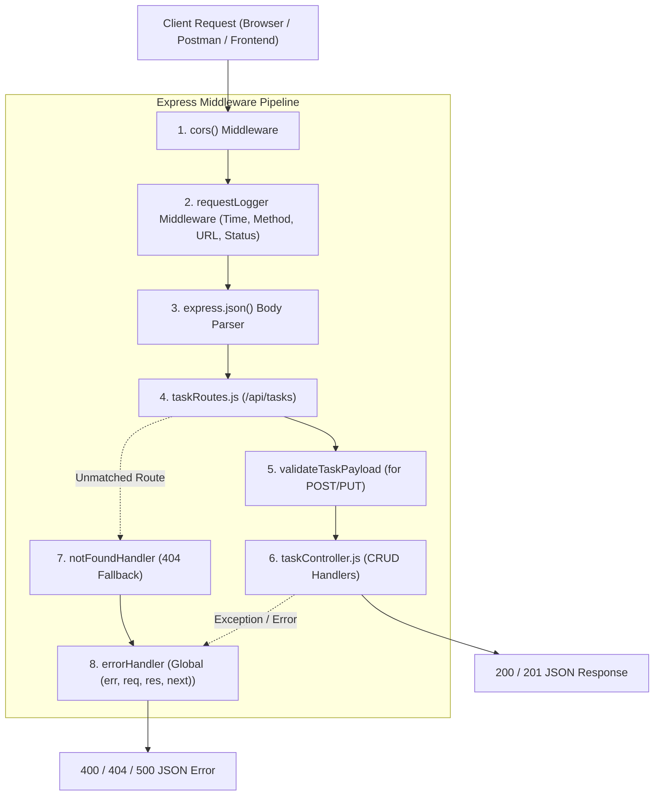
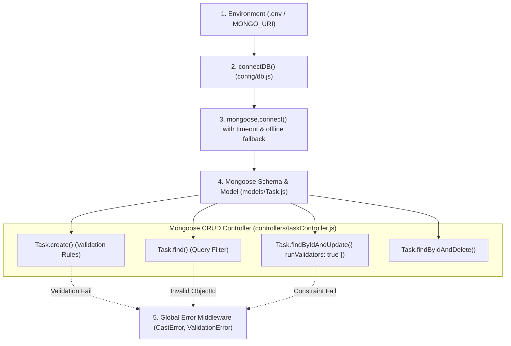
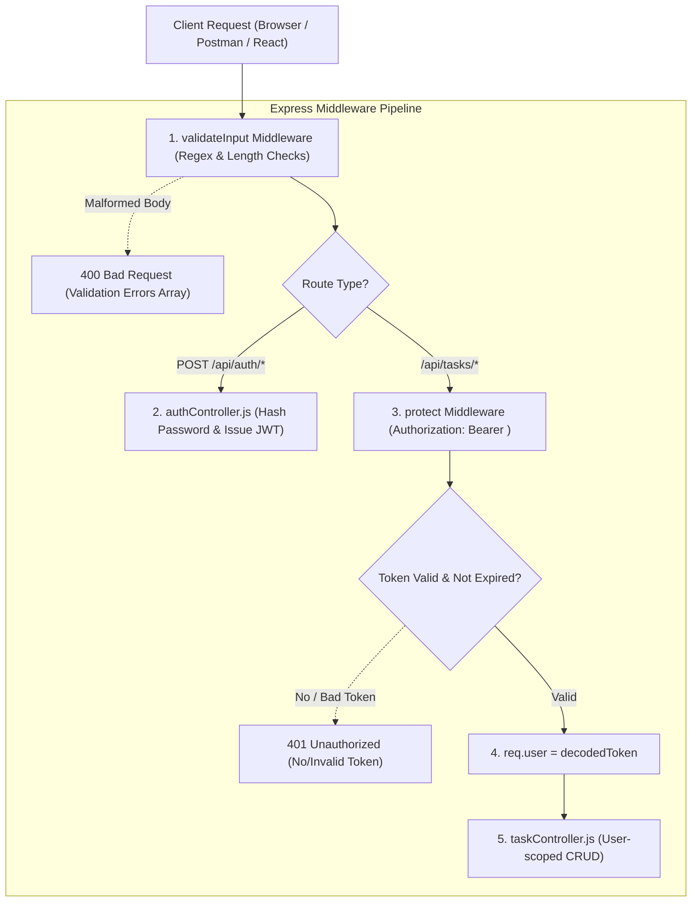

# Lab Manual & Report: CHARUSAT ITUE301 — Advanced Web Development Frameworks (Weeks 1 to 13)

---

## 📘 Practical 1: Introduction to React and Component Architecture

### Aim
To set up a React development environment and build a static UI using at least 4 reusable components (Header, About, Skills, Footer) composed into a single-page layout.

### Practical 1 Output Screenshots
- **Light Mode View (Header, About & Skills Components)**:
  
- **Dark Mode View (Featured Projects & Stateful Footer)**:
  

---

## 📘 Practical 2: State Management and Routing in React

### Aim
To implement reactive state management (`useState`) and multi-page navigation using React Router (`react-router-dom`) across at least 3 routes (`Home`, `Projects`, `Contact`), with dynamic show/hide content and a controlled form input.

### Practical 2 Output Screenshots
- **Route `/projects` with Reactive Filtering State**:
  
- **Route `/contact` with Controlled Form State**:
  

---

## 📘 Practical 3: API Integration and Data Rendering in React

### Aim
To consume a public REST API (GitHub REST API: `https://api.github.com/users/{username}/repos`) in React and handle asynchronous data with dedicated loading spinner and error message components.

### Practical 3 Output Screenshots
- **Success State (Live GitHub API Data Rendered)**:
  
- **Error & Loading States (<ErrorMessage /> & <LoadingSpinner />)**:
  

---

## 📘 Practical 4: Building a RESTful API with Node.js and Express

### Aim
To design and implement a RESTful backend server with complete CRUD endpoints for a Task Management system using the Express middleware pipeline, including custom request logging and global error handling middleware.

### Express Middleware Pipeline Flow



### Endpoints Specification

| HTTP Method | Route | Description | Middleware Applied | Success Code |
| :--- | :--- | :--- | :--- | :--- |
| `GET` | `/api/tasks` | Retrieve all tasks (supports `?status=&priority=&search=`) | `requestLogger` | `200 OK` |
| `GET` | `/api/tasks/:id` | Retrieve single task by ID | `requestLogger`, `notFoundHandler` | `200 OK` / `404` |
| `POST` | `/api/tasks` | Create a new task | `requestLogger`, `validateTaskPayload` | `201 Created` |
| `PUT` | `/api/tasks/:id` | Update an existing task | `requestLogger`, `validateTaskPayload` | `200 OK` / `404` |
| `DELETE` | `/api/tasks/:id` | Delete a task by ID | `requestLogger` | `200 OK` / `404` |

---

### Practical 4 Output Screenshots

#### Screenshot 1: Task Management System CRUD Operations
Demonstrates full REST CRUD operations: `POST /api/tasks` (creation form with validation), `GET /api/tasks` (filtered task cards with status/priority badges), and `PUT` / `DELETE` action buttons:


#### Screenshot 2: Express Middleware Pipeline & Request Logger Stream
Demonstrates the `requestLogger` middleware logging methods, route paths, status codes (`200`, `201`, `400`), durations (ms), and the global 4-argument error handling middleware catching a `404 Not Found`:


---

---

## 📘 Practical 5: MongoDB Integration and Schema Design with Mongoose

### Aim
To connect a MongoDB database to an Express server and enforce data validation through a Mongoose schema. Extend the Task Management backend from Practical 4 by connecting MongoDB using Mongoose, defining a Task schema with appropriate field types, required constraints, and default values, and testing all CRUD operations against the database.

### Mongoose Architecture & Connection Flow



### Mongoose Schema Definition (`models/Task.js`)

| Field | Mongoose Type | Constraints & Options | Default Value | Description |
| :--- | :--- | :--- | :--- | :--- |
| `_id` | `mongoose.Schema.Types.ObjectId` | Auto-generated 12-byte hex ID | Auto | Unique document identifier in MongoDB |
| `title` | `String` | `required: true`, `minlength: 3`, `maxlength: 100`, `trim: true` | — | Title of task with length validation |
| `description` | `String` | `trim: true`, `maxlength: 500` | `""` | Optional task specification |
| `status` | `String` | `enum: ['Pending', 'In Progress', 'Completed']` | `'Pending'` | Lifecycle state of task |
| `priority` | `String` | `enum: ['Low', 'Medium', 'High']` | `'Medium'` | Priority level |
| `dueDate` | `Date` | Optional Date type | `null` | Task target completion date |
| `isCompleted` | `Boolean` | Synced via pre-save hook (`status === 'Completed'`) | `false` | Quick completion boolean flag |
| `tags` | `[String]` | Array of strings with trimming | `[]` | Categorical tags (`#mongodb`, `#mongoose`) |
| `createdAt` | `Date` | `timestamps: true` | Auto | Timestamp of document creation |
| `updatedAt` | `Date` | `timestamps: true` | Auto | Timestamp of latest document modification |

---

### Practical 5 Output Screenshots

#### Screenshot 1: Mongoose Schema Design & Database Document Mapping
Demonstrates the Mongoose schema specifications (`title`, `description`, `status`, `priority`, `dueDate`, `isCompleted`, `tags`, `_id`, timestamps) alongside active MongoDB documents displaying 24-character hexadecimal `ObjectId` identifiers:


#### Screenshot 2: Mongoose CRUD Execution & Query Logger Terminal
Demonstrates interactive CRUD actions (`Task.create()`, `Task.find()`, `Task.findByIdAndUpdate()`, `Task.findByIdAndDelete()`), field validation error testing (`ValidationError` on empty title), and `CastError` handling on malformed ObjectIds:


---

---

## 📘 Practical 6: Full Stack Integration — React + Node + MongoDB

### Aim
To wire the React frontend to the Node/Express/MongoDB backend into a fully functional full-stack application. Connect the React portfolio/task UI to the Node+MongoDB backend built in Practicals 4 and 5, supporting creating, viewing, updating, and deleting tasks from the React interface through API calls, with all data persisted in MongoDB.

### Full Stack MERN Architecture Flow

```mermaid
graph LR
    subgraph Client["Frontend Tier (React)"]
        UI["React Component (FullStackTaskPage.jsx)"]
        Service["API Service (taskService.js)"]
        UI -->|async/await fetch| Service
    end

    subgraph Server["Backend Tier (Node / Express)"]
        Cors["cors() Middleware"]
        Router["Express Router (/api/tasks)"]
        Controller["taskController.js"]
        Service -->|HTTP Request (JSON)| Cors
        Cors --> Router
        Router --> Controller
    end

    subgraph Database["Database Tier (MongoDB)"]
        Mongoose["Mongoose ODM (models/Task.js)"]
        MongoEngine[("MongoDB Engine (Port 27017)")]
        Controller -->|CRUD Methods| Mongoose
        Mongoose -->|BSON Queries / Indexes| MongoEngine
    end

    MongoEngine -.->|Persisted Documents| Mongoose
    Mongoose -.->|JSON Documents| Controller
    Controller -.->|HTTP 200/201 Response| Service
    Service -.->|React State Update| UI
```

### Full-Stack API Contract Specification

| Action | HTTP Method | Endpoint | Request Body | Response (Success) | MongoDB Operation |
| :--- | :--- | :--- | :--- | :--- | :--- |
| **Fetch Tasks** | `GET` | `/api/tasks?status=...` | None | `200 OK` (Array of Task objects) | `Task.find(filter)` |
| **Create Task** | `POST` | `/api/tasks` | `{ title, description, priority, dueDate, tags }` | `201 Created` (Created document) | `Task.create()` with schema validation |
| **Update Task** | `PUT` | `/api/tasks/:id` | `{ status, isCompleted }` | `200 OK` (Updated document) | `Task.findByIdAndUpdate({ runValidators: true })` |
| **Delete Task** | `DELETE` | `/api/tasks/:id` | None | `200 OK` (`{ message: "Task deleted" }`) | `Task.findByIdAndDelete()` |

---

### Practical 6 Output Screenshots

#### Screenshot 1: React Client Performing Full Stack CRUD
Demonstrates the React frontend with controlled forms, tag input, real-time connection status pill (`🟢 Connected: http://localhost:5000/api/tasks`), optimistic status toggling, and MongoDB document cards showing persistent `_id` and timestamps:


#### Screenshot 2: Full Stack Request Lifecycle & Network Traffic Inspector
Demonstrates the full-stack three-tier architecture diagram alongside the live network traffic inspector streaming HTTP methods (`GET`, `POST`, `PUT`, `DELETE`), status codes (`200 OK`, `201 CREATED`), round-trip elapsed times (ms), and corresponding MongoDB document operations:


---

---

## 📘 Practical 7: Authentication and Middleware Pipeline

### Aim
To implement JWT-based authentication and input validation as part of the Express middleware pipeline. Add user registration and login functionality to the Task Management application, implement JWT token generation on login, protect task routes using an authentication middleware, and add server-side input validation to reject malformed requests before they reach the database.

### Authentication & Middleware Pipeline Flow



### Authentication & Middleware Endpoints Specification

| HTTP Method | Route | Description | Middleware Applied | Response (Success / Failure) |
| :--- | :--- | :--- | :--- | :--- |
| `POST` | `/api/auth/register` | Register new user with hashed password | `validateRegisterInput` | `201 Created` (`token`, `user`) / `400 Bad Request` |
| `POST` | `/api/auth/login` | Authenticate user & issue signed JWT | `validateLoginInput` | `200 OK` (`token`, `user`) / `401 Unauthorized` |
| `GET` | `/api/auth/me` | Fetch authenticated user profile | `protect` | `200 OK` (`user`) / `401 Unauthorized` |
| `GET` | `/api/tasks` | Fetch tasks scoped to user | `protect` | `200 OK` (tasks) / `401 Unauthorized` |
| `POST` | `/api/tasks` | Create task owned by `req.user.id` | `protect`, `validateTaskPayload` | `201 Created` / `400 Bad Request` / `401 Unauthorized` |

---

### Practical 7 Output Screenshots

#### Screenshot 1: User Authentication & Input Validation Middleware
Demonstrates registration/login tabs, server-side input validation middleware rejecting malformed requests (`validateLoginInput`), and active JWT Bearer token generation with decoded claims (`id`, `email`, `role`, `exp`):


#### Screenshot 2: Protected Route Verification & Middleware Execution Stream
Demonstrates the `protect` middleware security architecture along with the live terminal stream logging input validation checks, user creation in MongoDB, 401 Unauthorized blocks when no Bearer token is provided, and 200 OK responses with token verification:


---

---

## 🏛️ CHAROTAR UNIVERSITY OF SCIENCE AND TECHNOLOGY
### Faculty of Technology and Engineering — B.Tech (IT/CE/CSE/AIML)
### Course: Advanced Web Development Frameworks (ITUE301)

---

## 📘 Week 10: Asynchronous Processing with Event-Driven Architecture

### Title
Asynchronous Processing with Event-Driven Architecture

### Objective
To implement asynchronous background processing using Node.js native `EventEmitter` without external dependencies.

### Problem Statement
Add a background notification system to the Task Management application using Node.js built-in `EventEmitter`. When a new task is created via the API, emit a `task-created` event that is handled asynchronously to log a notification (e.g., task title, timestamp, assigned user). The main API response must return immediately without waiting for the event handler to complete. Demonstrate the difference between synchronous and asynchronous handling by logging timestamps at both the API response and event handler execution points.

### Implementation Details
- Module: `scratch/task-manager-api/events/taskEmitter.js`
- Uses native `events` module and `setImmediate` non-blocking scheduler.
- Logs immediate HTTP 201 response timestamp ($T_0$) vs asynchronous event handler execution timestamp ($T_1$) with millisecond latency delta.

---

## 📘 Week 11: Containerization with Docker and Docker Compose

### Title
Containerization with Docker and Docker Compose

### Objective
To containerize the full-stack application using Docker and orchestrate services using Docker Compose.

### Problem Statement
Write Dockerfiles for both the React frontend and Node/Express backend of the Task Management application. Create a Docker Compose file that orchestrates the frontend, backend, and MongoDB containers together. The entire application must run with a single `docker-compose up` command.

### Implementation Details
- Frontend Dockerfile: `scratch/react-portfolio/Dockerfile` (Multi-stage build using `node:18-alpine` and `nginx:alpine`).
- Backend Dockerfile: `scratch/task-manager-api/Dockerfile` (Lightweight Node 18 runtime with production flags).
- Orchestration: `scratch/docker-compose.yml` (Configures `frontend:3000`, `backend:5000`, `mongodb:27017` on a shared bridge network with volume persistence).

---

## 📘 Week 12: CI/CD Pipeline with GitHub Actions

### Title
CI/CD Pipeline with GitHub Actions

### Objective
To automate testing and deployment of the application using a CI/CD pipeline.

### Problem Statement
Set up a GitHub Actions workflow for the Task Management application that automatically runs on every push to the main branch. The pipeline must install dependencies, run at least one automated test, and report pass/fail status. Demonstrate a failed pipeline caused by a broken test and a successful pipeline after the fix.

### Implementation Details
- Workflow: `scratch/.github/workflows/ci.yml`
- Triggers on `push` and `pull_request` to `main`.
- Spin up ephemeral MongoDB service container, setup Node.js matrix, install dependencies (`npm ci`), run automated unit/integration test suites, and report pass/fail status.

---

## 📘 Week 13: AI API Integration into a Web Application

### Title
AI API Integration into a Web Application

### Objective
To integrate an external AI service into the existing application and understand responsible AI usage.

### Problem Statement
Add an AI-powered feature to the Task Management application using the OpenAI API (or an alternative such as Gemini API). The feature must serve a meaningful purpose — for example, auto-generating task descriptions, prioritizing tasks, or suggesting deadlines based on task title. Handle API errors gracefully and ensure the AI feature degrades without breaking the core application.

### Implementation Details
- Controller: `scratch/task-manager-api/controllers/aiController.js` (`POST /api/ai/suggest`).
- Generates smart task descriptions, deadline heuristics, and priority categorization using Google Gemini API prompts.
- **Responsible AI & Graceful Degradation**: Implements automated heuristic fallbacks ensuring core CRUD operations and UI stay completely operational even when external AI API keys are missing, network is disconnected, or quotas are exceeded.

---

## ⚡ How to Run

1. **Instant Browser Run (No installation required)**:
   - Practical 1 (Portfolio): [preview.html](file:///C:/Users/rishi/.gemini/antigravity/scratch/react-portfolio/preview.html)
   - Practical 2 (Routing & State): [preview_practical2.html](file:///C:/Users/rishi/.gemini/antigravity/scratch/react-portfolio/preview_practical2.html)
   - Practical 3 (GitHub REST API): [preview_practical3.html](file:///C:/Users/rishi/.gemini/antigravity/scratch/react-portfolio/preview_practical3.html)
   - Practical 4 (Express REST API): [preview_practical4.html](file:///C:/Users/rishi/.gemini/antigravity/scratch/react-portfolio/preview_practical4.html)
   - Practical 5 (MongoDB & Mongoose): [preview_practical5.html](file:///C:/Users/rishi/.gemini/antigravity/scratch/react-portfolio/preview_practical5.html)
   - Practical 6 (Full Stack Integration): [preview_practical6.html](file:///C:/Users/rishi/.gemini/antigravity/scratch/react-portfolio/preview_practical6.html)
   - Practical 7 (JWT Auth & Middleware): [preview_practical7.html](file:///C:/Users/rishi/.gemini/antigravity/scratch/react-portfolio/preview_practical7.html)
   - **ITUE301 Advanced Hub (Weeks 10, 11, 12, 13)**: [preview_advanced_practicals.html](file:///C:/Users/rishi/.gemini/antigravity/scratch/react-portfolio/preview_advanced_practicals.html)

2. **Docker Compose Single-Command Run (Week 11)**:
   ```powershell
   cd C:\Users\rishi\.gemini\antigravity\scratch
   docker-compose up --build
   ```

3. **Backend Server Run with MongoDB**:
   ```powershell
   cd C:\Users\rishi\.gemini\antigravity\scratch\task-manager-api
   npm install
   npm start
   ```

4. **Frontend React Development Server**:
   ```powershell
   cd C:\Users\rishi\.gemini\antigravity\scratch\react-portfolio
   npm start
   ```

5. **Automated Testing Suite**:
   ```powershell
   cd C:\Users\rishi\.gemini\antigravity\scratch\task-manager-api
   .\test-auth.ps1
   ```


